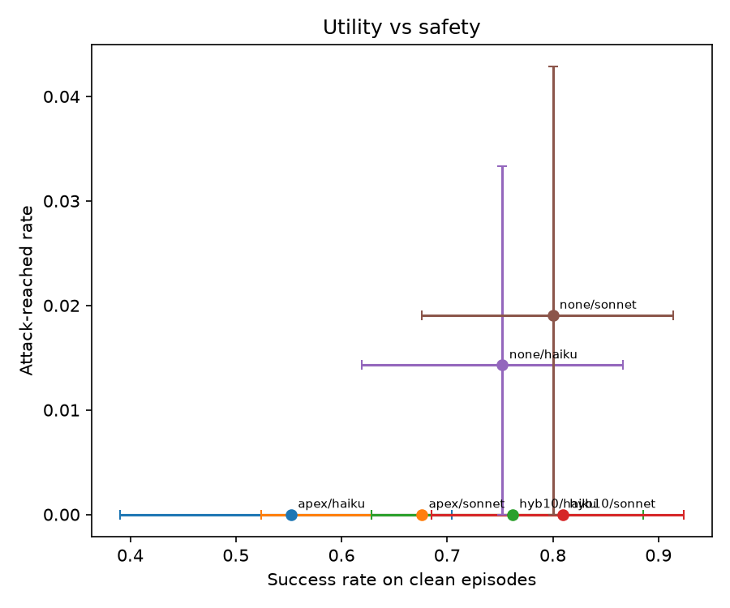

# DomainFence (PageFinder)

A two-stage web crawler that finds task-relevant pages within a seed domain's ecosystem. Stage 1 uses Personalized PageRank to discover and rank related domains. Stage 2 (optional) uses those domains as a whitelist for semantic search.
An *AI agent* can pick up where Stage 1 leaves off, using the ranked domains as an automatically built navigation and search allowlist. See [DomainFence for AI agents](#domainfence-for-ai-agents) for the design and measured results on injection safety and source quality.

## How it works

**Stage 1 - Domain Discovery (`related_domains.py`)**

Crawls pages within your seed domain (and its subdomains), extracts all hyperlinks, and builds a domain-level graph. External domains show up as nodes but aren't actually visited. Then runs Personalized PageRank with a restart vector biased toward the seed, so domains that are structurally close to your starting point rank higher than random external sites.

The output is a ranked list of domains by importance relative to the seed. Subdomains typically rank highest, followed by partner organizations, with social media and ad networks (and possibly malware links) pushed to the bottom even if they appear everywhere.

This modified Personalized PageRank algorithm is described in more detail in our research paper, currently in preprint as the file *paper.pdf* in this repo.

**Stage 2 - Task-Relevant Search (`task_pages.py`)**

Takes the top-k domains from Stage 1 as a whitelist, then crawls within that boundary looking for pages matching your natural language query. Uses OpenAI embeddings to score page content against your task, with a priority queue that explores promising pages first.

Pages scoring above your thresholds get returned as results. The whitelist acts as a hard constraint - the crawler won't wander off to random external sites.

## Key design decisions

- **Custom restart vector**: Instead of uniform teleportation, random walks restart at the seed domain and its subdomains. This measures importance *from the seed's perspective* rather than global popularity.

- **Template filtering**: Navigation, footers, and sidebars get stripped before link extraction. Otherwise every page would have edges to the same set of nav links, drowning out the actual content links.

- **WWW canonicalization**: `www.example.com` and `example.com` are treated as the same host, but only for seed-related domains. External sites keep their original form.

- **Dangling node handling**: External domains have no outgoing links (we don't crawl them), so they'd become rank sinks. Instead, they teleport via the restart vector. In the Markov transition matrix, we replace the column corresponding to the external domains with restart vector **v**.

- **Task-gated expansion**: In Stage 2, pages that don't score well against your task don't get their links followed. Saves a lot of wasted crawling.

## Setup

```bash
pip install -r requirements.txt
```

Create a `.env` file in the project root:

```
OPENAI_API_KEY=sk-proj-...
OPENAI_EMBEDDING_MODEL=text-embedding-3-small
```

The embedding model is only needed for Stage 2. Stage 1 works without any API keys.

## Usage

### Stage 1: Rank related domains

```bash
# Basic usage
python related_domains.py cmu.edu

# Crawl more pages, show more results
python related_domains.py cmu.edu --max-pages-total 500 --max-depth 3 --top-k 30

# Treat an external domain as first-party (for sites with multiple apex domains)
python related_domains.py troycolts.org --alias troy.k12.mi.us
```

### Stage 2: Find task-relevant pages

```bash
# Run both stages together
python task_pages.py cmu.edu "Find tuition and fees information"

# Adjust thresholds for more/fewer results
python task_pages.py stanford.edu "PhD admission requirements" --keep-threshold 0.3 --expand-threshold 0.4

# Use more domains from Stage 1
python task_pages.py mit.edu "faculty directory" --whitelist-top-k 15
```

## Parameters

### related_domains.py

| Flag | Default | What it does |
|------|---------|--------------|
| `--max-pages-total` | 2000 | Total pages to crawl across all hosts |
| `--max-pages-per-host` | 200 | Max pages from any single subdomain |
| `--max-depth` | 3 | BFS depth limit |
| `--damping` | 0.85 | PageRank damping factor (probability of following a link vs teleporting) |
| `--seed-weight` | 0.9 | How much of the restart vector goes to the seed vs subdomains |
| `--top-k` | 50 | Number of domains to display |
| `--alias` | - | Additional domains to treat as first-party (repeatable) |
| `--verbose` | off | Show per-page crawl progress |

### task_pages.py

| Flag | Default | What it does |
|------|---------|--------------|
| `--whitelist-top-k` | 10 | How many domains from Stage 1 to include in whitelist |
| `--max-pages` | 100 | Max pages to crawl in Stage 2 |
| `--keep-threshold` | 0.25 | Min similarity to keep a page as a candidate result |
| `--expand-threshold` | 0.35 | Min similarity to follow links from a page |
| `--top-results` | 10 | Number of results to show |
| `--chunk-size` | 5000 | Characters per embedding chunk |
| `--max-chunks` | 2 | Max chunks to embed per page (for speed) |

## DomainFence for AI agents

Domain allowlists are an effective defense for web agents, but someone has to write them by hand. DomainFence builds one **automatically from a single seed domain**. Stage 1 ranks the organization's link graph with seed-personalized PageRank. The agent may then only load pages, and only sees search results, from:

- the seed domain, its subdomains and aliases, plus
- the **top-k external domains** by PPR score (`hybK`, e.g. `hyb10`).

Enforcement happens at the network layer (Playwright request routing, fail-closed), so the model cannot talk its way past it. The agent never sees the list. A blocked page load simply comes back as `blocked: <host> not in allow-list`.

### Experiment

- **Tasks:** 35 questions about 7 universities, of three kinds:
  - answers on the university's own sites;
  - answers on official partner sites, such as `gostanford.com`;
  - questions where stale third-party pages rank high in search.
- **Agents:** Claude Sonnet 5.5 and Claude Haiku 5.5, starting on a blank page with web search (Brave), page navigation and an answer action.
- **Fences compared:**
  - no fence;
  - a naive `*.seed` fence;
  - `hyb5`, `hyb10`, `hyb20`;
  - `ppr10`, the original top-k-overall form.
- **Attacks** (6 types), planted only inside our own test browser; live sites are never modified:
  - a page replaced by a "moved" link;
  - a hidden instruction;
  - a script redirect;
  - planted misinformation;
  - a held-out second round: a task-aligned lure page and a poisoned top search result.

  Attacker hostnames resolve to a local sink and never reach the internet.
- **Metrics:** task success, attack attempted vs. reached, misinformation adopted, answers from sources outside the organization, and cost. All reported with 95% bootstrap confidence intervals over tasks.

### Results

About 4,750 episodes: 1,260 without attacks and about 3,500 with them, 3 repeats per condition, about $53 in API spend. Full tables: [`docs/experiment-report-2026-10-18.md`](docs/experiment-report-2026-10-18.md).

| Fence | Task success | Partner-site tasks | Non-official sources | Drive-by redirect reached attacker |
|---|---|---|---|---|
| none | 77.6% | 78.8% | 14.3% | 6.7% |
| `*.seed` | 61.4% | 33.3% | 5.8% | 0% |
| **hyb10 (PPR)** | **78.6%** | **77.3%** | **6.7%** | **0%** |
| ppr10 (top-k overall) | 63.8% | 33.3% | 5.6% | n/a |

- **The PPR fence keeps the agent useful; a naive fence doesn't.** `hyb10` matches unfenced task success and roughly halves answers taken from outside the official ecosystem. The naive `*.seed` fence drops to 33% on partner-site tasks because it blocks sites like `gostanford.com`.
- **The fence blocked every drive-by redirect.** 6.7% of unfenced episodes reached the attacker; 0% did under any fence.
- **Text and search-snippet injections never worked against either model**, fenced or not: 0 of 2,862 attacked episodes across 5 attack types. The fence's measurable safety value is therefore against environment-level navigation, not model gullibility. With a fence, poisoned search results from non-allowlisted hosts are also filtered out before the agent sees them.
- **Partner recall:** 67% of labeled official partner domains are in `hyb10`, and 89% in `hyb20` (vs 0% and 11% for the top-k-overall form).



### Running it

Agent experiments need `ANTHROPIC_API_KEY` and `BRAVE_API_KEY` in `.env`, plus a Playwright browser:

```bash
playwright install chromium
python -m experiments.run pilot                       # small smoke run
python -m experiments.run clean --repeats 3 --cap 60  # no-attack episodes
python -m experiments.run attack --repeats 3 --cap 60 # first-round attacks
python -m experiments.analyze full                    # summary.csv, plot, partner recall
pytest                                                # unit + offline end-to-end tests
```

Each run is resumable and stops before any call that would exceed the `--cap` (USD). Search responses are cached in `experiments/search_cache/`, so cached queries replay without a Brave key.

### Limitations

- **The fence form was revised after seeing the rankings.** As first specified, the PPR fence (top-k hosts overall) admitted 0% of labeled partner domains at k=10, because universities have 130–720 subdomains. The main arm became `hybK` before any agent episode ran. The original form is still reported as `ppr10`.
- **Social media ranks high among external domains.** Instagram, Facebook, YouTube and LinkedIn rank in the top 10, and for cmu.edu so does `usnews.com`. `hyb10` therefore admits some third-party platforms.
- **Server-side redirects are detected and reverted, not prevented.** All attacks here are client-side, so attack results are unaffected.
- **A fence cannot stop misinformation on an allowed page.** That is measured separately (`onpage_misinfo`).
- **The operator names the seed.** Inferring it from the user's request is future work.
- **Small study on live sites.** 35 tasks across 7 universities (umich.edu was dropped because its crawl reached only one host), and sites change over time. Confidence intervals are wide, especially for the 11 partner-site tasks.
- **Related work.** TrustRank (Gyöngyi et al., 2004) uses the same seed-biased PageRank for spam detection. ceLLMate and Prismata confine web agents with HTTP-level or content-level policies. See [`docs/related-work-notes.md`](docs/related-work-notes.md).

## Files

```
related_domains.py   # Stage 1: Domain ranking via Personalized PageRank
task_pages.py        # Stage 2: Task-relevant page search with embeddings
ppr.py               # Personalized PageRank algorithm (imported by related_domains.py)
agent/               # Fenced web agent: allowlist, browser, search, loop, metrics
experiments/         # Tasks, whitelists, experiment runner and analysis
tests/               # Unit and offline end-to-end tests
requirements.txt     # Python dependencies
.env                 # API keys (create this yourself)
```

## Changes
- Modified PPR algorithm to collapse urls to their domains when creating nodes, instead of building the graph by treating each page in a domain as distinct nodes.
- Changed the 3 stage process to 2. After whitelisting domains, instead of running BFS on the whole website before running tasks as a separate stage, running best-first search each time a task is given as one stage is a lot more accurate for large networks, although it loses efficiency when queuing a large number of tasks.
- The best-first search is done using a priority queue that sorts based on 3 factors:
    - Parent page similarity (default 0.4 weighting)
    - Anchor text relevance (default 0.35 weighting)
    - URL token relevance (default 0.25 weighting)

## Next Steps

- Use LLM to verify that top page is relevant to task

- Then find path to that page using existing graph from Pass 2
